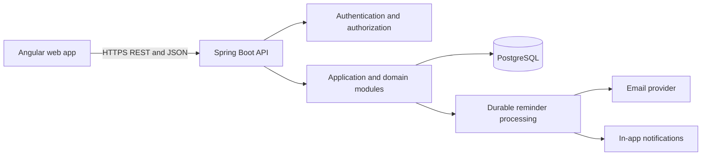

# Pet Vaccination Tracker: Project Context

## Purpose

This document is the shared product and engineering context for the Pet Vaccination Tracker. Use it to guide later decisions about folder structure, API contracts, database design, and starter implementation. Update it when a decision changes; do not treat undecided items as requirements.

## Product Summary

The application helps pet parents keep vaccination records organized and understand what is due next. A signed-in user can manage multiple pets, record vaccinations, review history, and receive reminders for upcoming or overdue items.

The application is a record-keeping and reminder tool, not a veterinary diagnostic or prescribing system. A due date is supplied or confirmed by the pet parent or veterinary professional. The system must not imply that it can determine a medically appropriate schedule from a vaccine name alone.

## Problem and Outcomes

Pet parents need one reliable place to answer:

- Which vaccinations does each pet have on record?
- What is due next, and when?
- Which vaccinations are upcoming or overdue?
- Where can I find a pet's vaccination history?

The product should make these answers quick to find, preserve a useful history, and send reminders reliably without replacing veterinary guidance.

## Users and Access

- **Pet parent (initial user):** owns an account and manages their own pets, vaccination records, and reminder preferences.
- **Veterinary professional (future user):** may contribute or review records only through an explicitly designed sharing and authorization model.
- **Household member (future user):** may receive delegated access to selected pets after sharing permissions are designed.

For the initial release, all application data is private to its owning account. Roles for clinics, staff, and shared households are future extensions, not implied access.

## Core Scope

### Initial release

- Account registration, sign-in, and sign-out.
- Create, view, update, and archive pet profiles.
- Add and review vaccination records for each pet.
- Record the vaccine name, administration date, next due date when known, veterinary provider when known, and notes.
- Dashboard summaries for pet count, upcoming vaccinations, overdue vaccinations, and recent records.
- Search and filter vaccination history by pet, vaccine, date, and due status.
- Reminder preferences and scheduled notifications for upcoming and overdue items.
- Responsive, accessible experiences for mobile, tablet, and desktop.

### Explicitly later

- Appointment scheduling and veterinary contacts.
- Medication tracking and broader medical records.
- Uploads for certificates, invoices, and other documents.
- Household sharing, clinic accounts, and veterinary integrations.
- Veterinarian-reviewed schedule recommendations.

Keep extension points clear, but do not build these features into the MVP without a separate scope decision.

## Main User Flows

### 1. Create an account and add a pet

1. The user registers or signs in.
2. The user adds a pet's basic profile, including name and species; birth date and other details are optional where unknown.
3. The user may add existing vaccination records or do this later.
4. The pet appears in the user's pet list and dashboard totals.

### 2. Record a vaccination

1. The user selects a pet and starts a vaccination record.
2. The user enters the vaccine and administration date, and optionally the provider and notes.
3. The user enters or confirms a next due date if known; the system may calculate a displayed date only from an explicitly supplied interval or configured, approved rule.
4. The system validates and saves the record, then updates history, dashboard status, and reminder work as applicable.

### 3. Review due items

1. The user opens the dashboard and sees upcoming and overdue items.
2. The user opens an item to see the pet, vaccine, due date, and related history.
3. The user can update the due date, adjust reminder preferences, or record a completed vaccination.
4. A completed vaccination is represented by a new history record; it does not erase the previous event.

### 4. Search vaccination history

1. The user opens a pet's history or the account-wide record list.
2. The user filters by pet, vaccine, date range, or status and can search vaccine/provider text.
3. The user opens a result to review its details and, subject to authorization, edit or archive it.

### 5. Receive and act on a reminder

1. A scheduled reminder becomes due according to the record's next due date, user preferences, and time zone.
2. The reminder worker queues or sends an in-app or email notification.
3. The user follows the notification to the relevant pet and record.
4. Updating or completing the record cancels or reschedules stale pending reminders.

## Business Rules

- A user may access only pets and records owned by that authenticated user in the MVP.
- A pet may have many vaccination records; each record belongs to exactly one pet.
- Historical records are retained. Corrections should be auditable and must not silently rewrite the event history.
- Administration and due dates are calendar dates, not instants. Persist them as date-only values; do not shift them across time zones.
- Reminder delivery is time-zone-aware. Store an IANA time-zone identifier in user preferences and use it when choosing a delivery time.
- A record with no next due date is valid and must not be classified as overdue or scheduled for a due-date reminder.
- Define and consistently apply the upcoming window (initial proposal: the next 30 calendar days, inclusive; confirm before implementation).
- A record is overdue when it has a known next due date earlier than the current local calendar date and has not been superseded or completed.
- Due-date calculations must have an explicit source: user-entered date, supplied interval, or a versioned/approved rule. Never silently infer medical guidance.
- Reminder processing must be durable and idempotent: retries must not create duplicate sends for the same reminder occurrence.
- Deleting a pet must not silently destroy important medical history. Prefer archive/soft-delete for the MVP and define retention/export behavior before adding permanent deletion.
- Validate input at both API and UI boundaries. Backend validation and authorization are authoritative.

## Dashboard Definitions

- **Pet count:** number of active pets owned by the signed-in user.
- **Upcoming:** active vaccination records with a known due date inside the configured upcoming window and not overdue.
- **Overdue:** active records with a known due date before today's date in the user's time zone, not completed or superseded.
- **Recent records:** most recently created or administered records; choose one ordering and label it clearly in the UI.

Dashboard counts and lists must be scoped to the authenticated user and should link to the underlying pet or record. The dashboard is a summary, not a separate source of truth.

## System Architecture

Use a modular monolith for the first release. It keeps deployment and local development manageable while preserving boundaries that can evolve as product needs grow.

### Frontend

- Angular application organized by product feature: authentication, dashboard, pets, vaccinations, and settings.
- Shared API client, route guards, form validation, and reusable accessible UI primitives.
- Use server responses as the source of truth; client-side checks improve feedback but do not replace server validation.
- Design for small screens first. Use compact record lists on narrow screens and richer table layouts where space permits.
- Provide clear loading, empty, validation-error, and request-failure states.

### Backend

- Java with Spring Boot exposing versionable REST endpoints under `/api`.
- Organize code around feature/domain boundaries, for example accounts, pets, vaccinations, and reminders.
- Keep controllers thin; put use-case orchestration in application services and business rules in domain logic.
- Use request/response DTOs at the API boundary; do not expose persistence entities directly.
- Enforce ownership in backend services or authorization policies on every object lookup and mutation.
- Use centralized exception handling and consistent validation/error response formats.

### Persistence and integrations

- PostgreSQL is the default database: the data is relational, ownership-sensitive, and likely to gain related medical-record features.
- Use versioned database migrations (Flyway or Liquibase; decide during implementation).
- Isolate email delivery behind an application interface so providers can be changed without changing vaccination logic.
- Run reminder processing as a scheduled worker in the Spring Boot application initially. Extract a separate worker only if scale or operational requirements warrant it.

## Initial Domain Model

- **User:** identity reference, account status, time zone, and notification preferences.
- **Pet:** owner, name, species, optional breed and birth date, timestamps, and archive status.
- **VaccinationRecord:** pet, vaccine label or optional catalog reference, administration date, optional next due date, provider and notes when known, audit timestamps, and status/archive metadata.
- **Reminder:** record reference, scheduled delivery time, channel, status, idempotency key, and attempt/error metadata.
- **Notification (optional MVP entity):** in-app message, recipient, target resource, read state, and timestamps.
- **VaccineCatalog (optional):** informational normalized vaccine names and species applicability; it is not itself a medical schedule.

Records and reminders should be separate concepts. A vaccination record states what happened and what due date is currently recorded; a reminder is delivery work generated from that state. Future appointments, medications, and documents should be separate domain entities linked to a pet, not overloaded into vaccination records.

## API Shape (Initial Proposal)

- `GET /api/pets` and `POST /api/pets`
- `GET /api/pets/{petId}`, `PATCH /api/pets/{petId}`, and `DELETE /api/pets/{petId}` (delete should archive unless retention rules say otherwise)
- `GET /api/pets/{petId}/vaccinations` and `POST /api/pets/{petId}/vaccinations`
- `GET /api/vaccinations/{recordId}`, `PATCH /api/vaccinations/{recordId}`, and `DELETE /api/vaccinations/{recordId}`
- `GET /api/dashboard`
- `GET /api/reminder-preferences` and `PATCH /api/reminder-preferences`

Collection endpoints should support pagination, stable sorting, and documented filters. Example vaccination filters: `petId`, `vaccine`, `from`, `to`, and `status`. Validate all identifiers against the signed-in user's ownership; an unowned identifier must not disclose whether another user's resource exists.

## Security and Privacy

- Prefer a well-supported OpenID Connect identity provider; if authentication is self-hosted, use Spring Security and established password/session/token practices rather than custom cryptography.
- Require HTTPS outside local development and keep secrets out of source control.
- Apply least privilege and verify ownership server-side on every pet, vaccination, reminder, and notification operation.
- Use short-lived credentials and secure browser storage/cookie practices appropriate to the chosen authentication flow.
- Rate-limit authentication and other abuse-sensitive endpoints.
- Avoid logging tokens, credentials, or unnecessary personal/medical details.
- Audit significant record changes and reminder delivery outcomes.
- Define data export, account deletion, retention, and backup/restore behavior before production launch.

## Quality Attributes

- **Maintainability:** feature-oriented modules, explicit API contracts, migrations, and automated tests.
- **Reliability:** persisted reminder work, retry handling, idempotent sends, and observable failures.
- **Security:** authenticated access, object-level ownership checks, input validation, and secret hygiene.
- **Accessibility:** keyboard operation, labeled controls, adequate contrast, semantic structure, and screen-reader-friendly status messages.
- **Responsive behavior:** usable phone layouts without horizontal overflow; test at phone, tablet, and desktop widths.
- **Observability:** structured logs, health checks, and metrics for API errors and reminder outcomes without exposing sensitive data.

## Testing Expectations

- Backend unit tests for date/status rules, validation, and reminder decisions.
- API integration tests for authentication, ownership isolation, validation errors, filtering, and persistence.
- Frontend tests for key forms, dashboard states, filters, and error handling.
- End-to-end coverage for account setup, adding a pet, recording a vaccination, and viewing an upcoming/overdue item.
- Explicit tests for date-only behavior, time-zone-aware reminder scheduling, retry idempotency, and cross-user access denial.

## Decisions to Confirm Before Implementation

- Authentication provider and browser session/token strategy.
- Initial notification channels (recommended: in-app plus email) and email provider.
- Upcoming window and reminder lead times/defaults.
- Whether users can permanently delete records or only archive them; data export and retention policy.
- Exact pet profile fields and whether a vaccine catalog is needed in the MVP.
- UI component/design system and supported browser baseline.
- Migration tool choice (Flyway or Liquibase).

Until confirmed, use the defaults and constraints stated above, and keep choices behind small, replaceable boundaries where practical.
